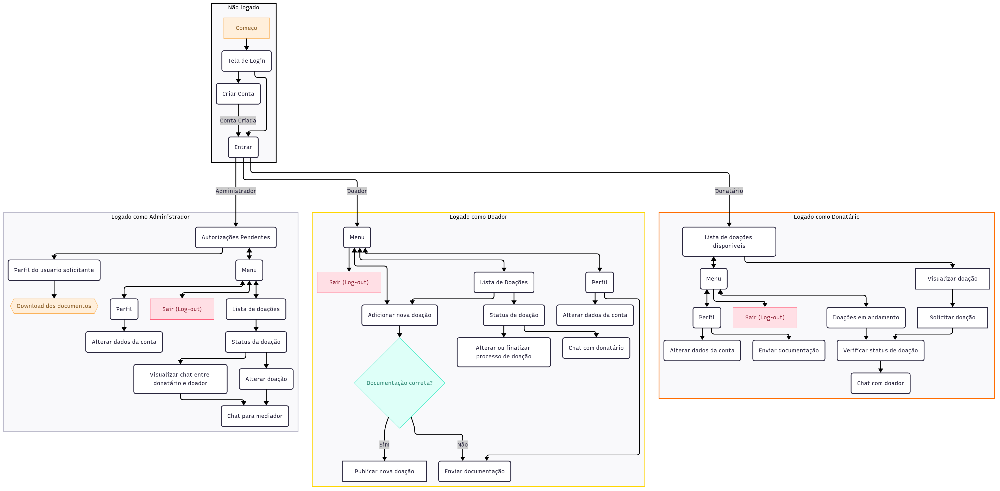

# Projeto de Interface

A ferramenta [MermaidChart](https://www.mermaidchart.com/) foi utilizada para fazer o fluxograma. Com ela foi possivel focar mais no desenvolvimento do fluxo, já que realmente ajuda muito não ter que organizar todo o fluxograma. Além disso, agiliza bastante o entendimento pra qualquer pessoa com a ótima organização do auto-layout.

Para os wireframes, optamos em usar o Figma, utilizando componentização de vários elementos. Isso agiliza o processo de modelagem da aplicação, além de facilitar o desenvolvimento, permitindo o uso da componentização no React. Um prototipo da aplicação para usuario pode ser acessada [aqui](www.figma.com/proto/vTlMcWAWfeE7jQHPOxAOX1/DoeTech---Mobile?node-id=0-1&p=f&t=GQNNpkmtTtoqcqHi-0&scaling=scale-down&content-scaling=fixed&page-id=0%3A1&starting-point-node-id=2%3A43https://www.mermaidchart.com/).

## Diagrama de Fluxo

O diagrama apresenta o estudo do fluxo de interação do usuário com o sistema interativo e  muitas vezes sem a necessidade do desenho do design das telas da interface. Isso permite que o design das interações seja bem planejado e gere impacto na qualidade no design do wireframe interativo que será desenvolvido logo em seguida.

Figura 1: Diagrama de fluxo (fluxograma).

## Wireframes

São protótipos usados em design de interface para sugerir a estrutura de um site web e seu relacionamentos entre suas páginas. Um wireframe web é uma ilustração semelhante do layout de elementos fundamentais na interface.

### Todos (Administrador/Receptor/Doador)

Figura 2: Inicío.

Figura 3: Login.

-wireframe.jpg)

Figura 4: Recuperação de senha.

-wireframe-1.jpg)

Figura 5: Recuperação de senha (modal).

Figura 6: Chat.

Figura 7: Lista de doações.

-wireframe.jpg)

Figura 8: Cadastro 1.

-wireframe.jpg)

Figura 9: Cadastro 2.

Figura 10: Menu (variação).

-wireframe.jpg)

Figura 11: Menu.

Figura 12: Perfil com documentação pendente.

Figura 13: Perfil aguardando autorização.

Figura 14: Perfil aprovado.

Figura 15: Editar conta.

### Receptor

Figura 16: Visualizar doação.

### Doador

Figura 17: Anunciar doação.

Figura 18: Doador com documentação pendente.

Figura 19: Status da doação.

Figura 20: Editar doação.

Figura 21: Alerta ao apagar doação (modal).

### Administrador

Figura 22: Menu.

autorizacoes-pendentes-wireframe.jpg)

Figura 23: Autorizações pendentes.

autorizar-perfil-wireframe.jpg)

Figura 24: Autorizar perfil.

perfil-wireframe.jpg)

Figura 25: Perfil administrador.

status-doacao-wireframe.jpg)

Figura 26: Status da doação.

-modal-chat-wireframe.jpg)

Figura 27: Abrir chat com participantes.

editar-conta-wireframe.jpg)

Figura 28: Editar conta.

ver-conversa-wireframe.jpg)

Figura 29: Visualizar conversa entre doador e receptor.

## Dashboards

Agora, os KPIs identificados e descritos na documentação de `Especificação do Projeto` foram utilizados para a construção de protótipos de dashboards para métricas da plataforma. Para tanto, foram utilizados gráficos e tabelas para a representação dos dados.

Figura 30: Dashboard de beneficiários.

Figura 31: Dashboard geral de administrador.

Figura 32: Dashboard de taxa de reutilização.

Figura 33: Dashboard de tempo médio de doações.

Figura 34: Dashboard de oferta e demanda.

