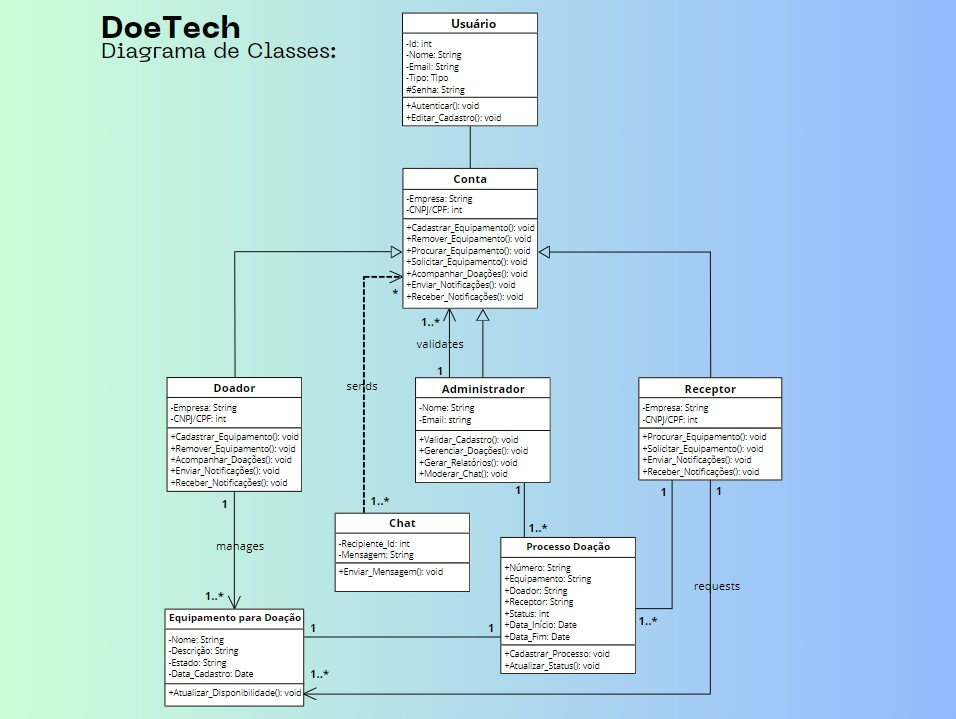
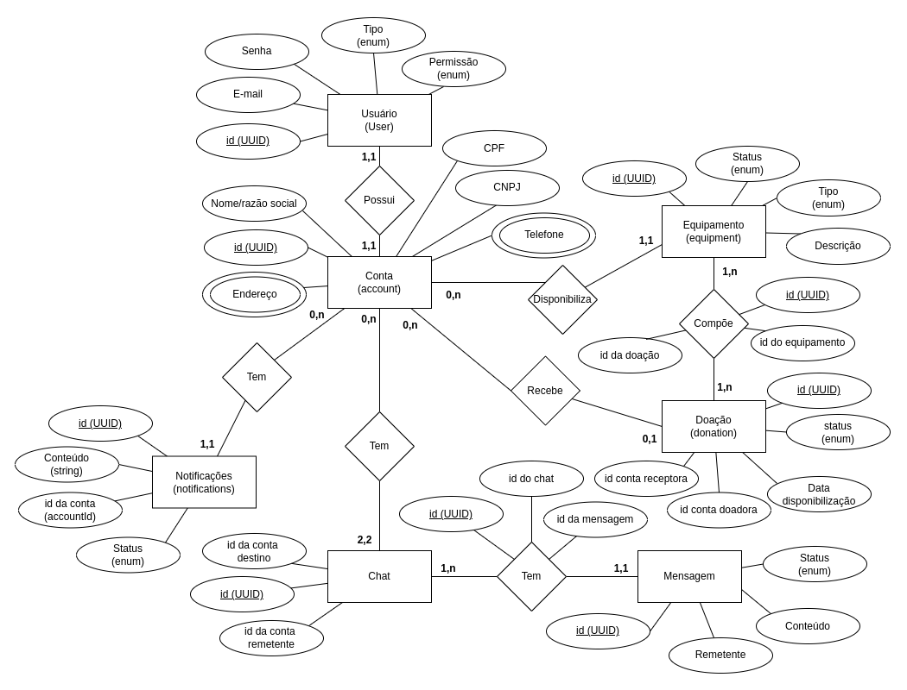
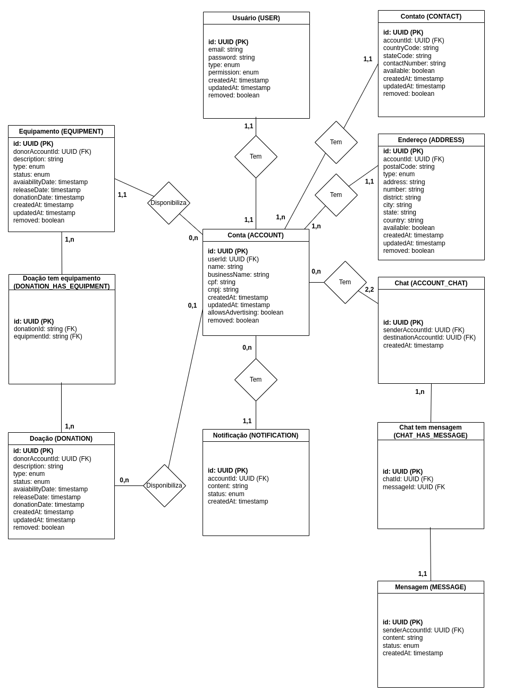
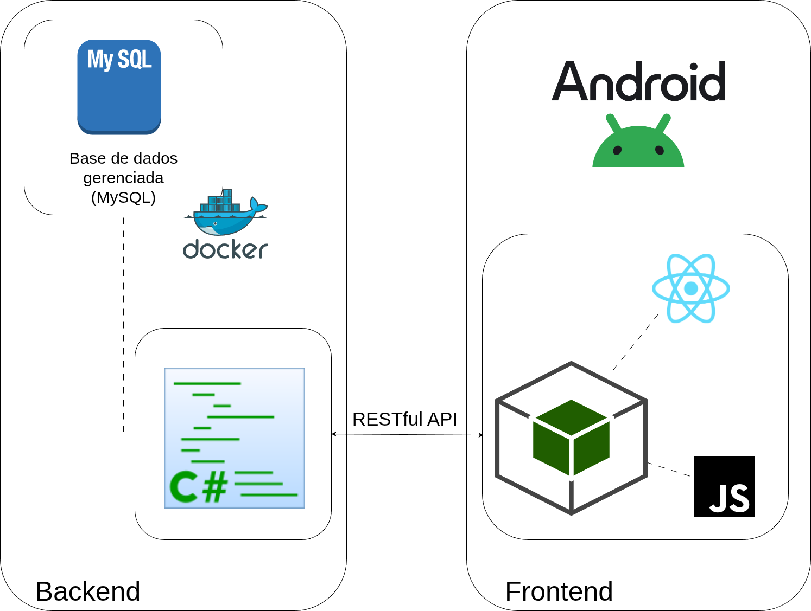

# Arquitetura da Solução

<div align="justify">

## Diagrama de Classes

O diagrama de classes (figura 1) ilustra graficamente como será a estrutura do software, e como cada uma das classes da sua estrutura estarão interligadas. Essas classes servem de modelo para materializar os objetos que executarão na memória.

<div align="center">



Figura 1: Diagrama de classes.

</div>

<hr>

## Modelo ER (Projeto Conceitual)

O Modelo Entidade-Relacionamento (figura 2) representa através de um diagrama como as entidades (coisas, objetos) se relacionam entre si na aplicação interativa.

<div align="center">



Figura 2: Modelo entidade relacionamento.

</div>

<hr>

## Projeto da Base de Dados

O projeto da base de dados (figura 3) corresponde à representação das entidades e relacionamentos identificadas no Modelo ER, no formato de tabelas, com colunas e chaves primárias/estrangeiras necessárias para representar corretamente as restrições de integridade.
 
<div align="center">



Figura 3: Projeto da base de dados da aplicação, com as tabelas e seus relacionamentos.

</div>

### Criação da base de dados (scripts DDL)

Abaixo, os scrips utilizados para criar as tabelas utilizadas pela aplicação web backend. Você também pode encontrar os scripts `.sql` [aqui](../src/sql/). Todas as tabelas foram criadas no schema `doetech`, e os scripts foram utilizados no MySQL versão 8.0.2. No momento do deploy na Azure, detectamos que o uso de bases MySQL não é permitido para contas de estudantes. Desta forma, fizemos a migração para o PostgreSQL, com as migrations que se encontram na aplicação backend.

#### Tabela `Accounts`

```sql
CREATE TABLE `Accounts` (
  `Id` char(36) CHARACTER SET ascii COLLATE ascii_general_ci NOT NULL,
  `UserId` char(36) CHARACTER SET ascii COLLATE ascii_general_ci NOT NULL,
  `Name` varchar(100) CHARACTER SET utf8mb4 COLLATE utf8mb4_0900_ai_ci DEFAULT NULL,
  `BusinessName` varchar(100) CHARACTER SET utf8mb4 COLLATE utf8mb4_0900_ai_ci DEFAULT NULL,
  `Cpf` varchar(11) CHARACTER SET utf8mb4 COLLATE utf8mb4_0900_ai_ci DEFAULT NULL,
  `Cnpj` varchar(14) CHARACTER SET utf8mb4 COLLATE utf8mb4_0900_ai_ci DEFAULT NULL,
  `BirthdayDate` bigint NOT NULL,
  `AddressStreet` varchar(150) CHARACTER SET utf8mb4 COLLATE utf8mb4_0900_ai_ci NOT NULL,
  `AddressNumber` varchar(150) CHARACTER SET utf8mb4 COLLATE utf8mb4_0900_ai_ci NOT NULL,
  `AddressCity` varchar(150) CHARACTER SET utf8mb4 COLLATE utf8mb4_0900_ai_ci NOT NULL,
  `AddressDistrict` varchar(150) CHARACTER SET utf8mb4 COLLATE utf8mb4_0900_ai_ci NOT NULL,
  `AddressState` varchar(40) CHARACTER SET utf8mb4 COLLATE utf8mb4_0900_ai_ci NOT NULL,
  `AddressComplement` varchar(150) CHARACTER SET utf8mb4 COLLATE utf8mb4_0900_ai_ci DEFAULT NULL,
  `AddressPostalCode` varchar(15) CHARACTER SET utf8mb4 COLLATE utf8mb4_0900_ai_ci NOT NULL,
  `PhoneCountryCode` varchar(5) CHARACTER SET utf8mb4 COLLATE utf8mb4_0900_ai_ci NOT NULL,
  `PhoneStateCode` varchar(5) CHARACTER SET utf8mb4 COLLATE utf8mb4_0900_ai_ci NOT NULL,
  `PhoneNumber` varchar(15) CHARACTER SET utf8mb4 COLLATE utf8mb4_0900_ai_ci DEFAULT NULL,
  `Role` longtext CHARACTER SET utf8mb4 COLLATE utf8mb4_0900_ai_ci NOT NULL,
  `CreatedAt` bigint NOT NULL,
  `UpdatedAt` bigint NOT NULL,
  `AllowsAdvertising` tinyint(1) NOT NULL,
  `Removed` tinyint(1) NOT NULL,
  `Active` tinyint(1) NOT NULL DEFAULT '0',
  PRIMARY KEY (`Id`)
) ENGINE=InnoDB DEFAULT CHARSET=utf8mb4 COLLATE=utf8mb4_0900_ai_ci;
SELECT * FROM doetech.Users;
```

#### Tabela `Chats`

```sql
CREATE TABLE `Chats` (
  `Id` char(36) CHARACTER SET ascii COLLATE ascii_general_ci NOT NULL,
  `SenderAccountId` char(36) CHARACTER SET ascii COLLATE ascii_general_ci NOT NULL,
  `ReceiverAccountId` char(36) CHARACTER SET ascii COLLATE ascii_general_ci NOT NULL,
  `CreatedAt` bigint NOT NULL,
  `UpdatedAt` bigint NOT NULL,
  `Removed` tinyint(1) NOT NULL,
  PRIMARY KEY (`Id`)
) ENGINE=InnoDB DEFAULT CHARSET=utf8mb4 COLLATE=utf8mb4_0900_ai_ci;
```

#### Tabela `DonationEquipments`

```sql
CREATE TABLE `DonationEquipments` (
  `Id` char(36) CHARACTER SET ascii COLLATE ascii_general_ci NOT NULL,
  `DonationId` char(36) CHARACTER SET ascii COLLATE ascii_general_ci NOT NULL,
  `EquipmentId` char(36) CHARACTER SET ascii COLLATE ascii_general_ci NOT NULL,
  PRIMARY KEY (`Id`),
  UNIQUE KEY `IX_DonationEquipments_DonationId_EquipmentId` (`DonationId`,`EquipmentId`),
  CONSTRAINT `FK_DonationEquipments_Donations_DonationId` FOREIGN KEY (`DonationId`) REFERENCES `Donations` (`Id`) ON DELETE CASCADE
) ENGINE=InnoDB DEFAULT CHARSET=utf8mb4 COLLATE=utf8mb4_0900_ai_ci;
```
<hr>

#### Tabela `Donations`

```sql
CREATE TABLE `Donations` (
  `Id` char(36) CHARACTER SET ascii COLLATE ascii_general_ci NOT NULL,
  `RecipientAccountId` char(36) CHARACTER SET ascii COLLATE ascii_general_ci NOT NULL,
  `Status` longtext CHARACTER SET utf8mb4 COLLATE utf8mb4_0900_ai_ci NOT NULL,
  `Removed` tinyint(1) NOT NULL DEFAULT '0',
  `CreatedAt` bigint NOT NULL,
  `UpdatedAt` bigint NOT NULL,
  `FinishedAt` bigint NOT NULL,
  `RowVersion` timestamp(6) NULL DEFAULT CURRENT_TIMESTAMP(6) ON UPDATE CURRENT_TIMESTAMP(6),
  PRIMARY KEY (`Id`)
) ENGINE=InnoDB DEFAULT CHARSET=utf8mb4 COLLATE=utf8mb4_0900_ai_ci;
```

#### Tabela `Equipments`

```sql
CREATE TABLE `Equipments` (
  `Id` char(36) CHARACTER SET ascii COLLATE ascii_general_ci NOT NULL,
  `DonorAccountId` char(36) CHARACTER SET ascii COLLATE ascii_general_ci NOT NULL,
  `Description` longtext CHARACTER SET utf8mb4 COLLATE utf8mb4_0900_ai_ci NOT NULL,
  `Type` int NOT NULL,
  `Status` int NOT NULL,
  `AvaiabilityDate` bigint NOT NULL,
  `CreatedAt` bigint NOT NULL,
  `UpdatedAt` bigint NOT NULL,
  `Removed` tinyint(1) NOT NULL DEFAULT '0',
  `RowVersion` timestamp(6) NULL DEFAULT CURRENT_TIMESTAMP(6) ON UPDATE CURRENT_TIMESTAMP(6),
  PRIMARY KEY (`Id`)
) ENGINE=InnoDB DEFAULT CHARSET=utf8mb4 COLLATE=utf8mb4_0900_ai_ci;
```

#### Tabela `HealthStatuses`

```sql
CREATE TABLE `HealthStatuses` (
  `build` varchar(255) CHARACTER SET utf8mb4 COLLATE utf8mb4_0900_ai_ci NOT NULL,
  `version` longtext CHARACTER SET utf8mb4 COLLATE utf8mb4_0900_ai_ci,
  `name` longtext CHARACTER SET utf8mb4 COLLATE utf8mb4_0900_ai_ci,
  `releaseDate` longtext CHARACTER SET utf8mb4 COLLATE utf8mb4_0900_ai_ci,
  `status` longtext CHARACTER SET utf8mb4 COLLATE utf8mb4_0900_ai_ci,
  `code` int NOT NULL,
  PRIMARY KEY (`build`)
) ENGINE=InnoDB DEFAULT CHARSET=utf8mb4 COLLATE=utf8mb4_0900_ai_ci;
```

#### Tabela `Messages`

```sql
CREATE TABLE `Messages` (
  `Id` char(36) CHARACTER SET ascii COLLATE ascii_general_ci NOT NULL,
  `ChatId` char(36) CHARACTER SET ascii COLLATE ascii_general_ci NOT NULL,
  `AccountId` char(36) CHARACTER SET ascii COLLATE ascii_general_ci NOT NULL,
  `Content` varchar(500) CHARACTER SET utf8mb4 COLLATE utf8mb4_0900_ai_ci NOT NULL,
  `CreatedAt` bigint NOT NULL,
  `UpdatedAt` bigint NOT NULL,
  `Removed` tinyint(1) NOT NULL,
  PRIMARY KEY (`Id`),
  KEY `IX_Messages_ChatId` (`ChatId`),
  CONSTRAINT `FK_Messages_Chats_ChatId` FOREIGN KEY (`ChatId`) REFERENCES `Chats` (`Id`) ON DELETE CASCADE
) ENGINE=InnoDB DEFAULT CHARSET=utf8mb4 COLLATE=utf8mb4_0900_ai_ci;
```

#### Tabela `Notifications`

```sql
CREATE TABLE `Notifications` (
  `Id` char(36) CHARACTER SET ascii COLLATE ascii_general_ci NOT NULL,
  `Content` varchar(600) CHARACTER SET utf8mb4 COLLATE utf8mb4_0900_ai_ci NOT NULL,
  `AccountId` char(36) CHARACTER SET ascii COLLATE ascii_general_ci NOT NULL,
  `Read` tinyint(1) NOT NULL,
  `CreatedAt` bigint NOT NULL,
  `UpdatedAt` bigint NOT NULL,
  `Removed` tinyint(1) NOT NULL,
  `Title` varchar(250) CHARACTER SET utf8mb4 COLLATE utf8mb4_0900_ai_ci NOT NULL,
  PRIMARY KEY (`Id`)
) ENGINE=InnoDB DEFAULT CHARSET=utf8mb4 COLLATE=utf8mb4_0900_ai_ci;
```

#### Tabela `Users`

```sql
CREATE TABLE `Users` (
  `Id` char(36) CHARACTER SET ascii COLLATE ascii_general_ci NOT NULL,
  `Email` varchar(100) CHARACTER SET utf8mb4 COLLATE utf8mb4_0900_ai_ci NOT NULL,
  `Password` varchar(100) CHARACTER SET utf8mb4 COLLATE utf8mb4_0900_ai_ci NOT NULL,
  `IsAdmin` tinyint(1) NOT NULL,
  `CreatedAt` bigint NOT NULL,
  `UpdatedAt` bigint NOT NULL,
  `Removed` tinyint(1) NOT NULL,
  PRIMARY KEY (`Id`)
) ENGINE=InnoDB DEFAULT CHARSET=utf8mb4 COLLATE=utf8mb4_0900_ai_ci;
```

## Tecnologias Utilizadas

A arquitetura da aplicação (figura 4) foi modelada para utilizar as seguintes tecnologias:

### Backend

Para o backend, a aplicação utiliza:

#### Linguagem de programação e frameworks da implementação

A implementação utiliza a **linguagem C#** (versão 9.0), junto aos frameworks (pacotes NuGet) que se seguem:

* **Microsoft.EntityFrameworkCore.Design** - Entity Manager Core (versão 9.0.3);
* **Microsoft.AspNetCore.Mvc.NewtonsoftJson** (versão 9.0.3);
* **Microsoft.Extensions.Configuration.Abstractions** (versão 9.0.3);
* **Microsoft.AspNet.WebApi.Versioning** (versão 5.1.0);
* **Microsoft.AspNetCore.Mvc.Core** (versão 2.3.0);
* **Microsoft.AspNetCore.Mvc.Versioning** (versão 5.1.0);
* **Newtonsoft.Json** (versão 13.0.3);
* **Npgsql.EntityFrameworkCore.PostgreSQL** (versão 10.0.0-rc.2);
* **Azure.Storage.Blobs** (versão 12.24.1).

> Vale ressaltar que cada pacote também implementa suas próprias dependências.

#### *Integrated Development Environment* (IDE)

Foram selecionadas e validadas duas IDEs para o desenvolvimento. O **Visual Studio Community 2022** foi selecionado para o desenvolvimento em ambiente Windows, enquanto uma IDE totalmente compatível, **JetBrains Rider** (versão 2024.3.5), foi selecionada para o desenvolvimento em ambientes Linux. O **Visual Studio Code** foi selecionado para permitir a criação e edição de documentação e contratos Swagger. Para mais informações, leia mais sobre a justificativa de escolha de cada IDE [aqui](./03-Metodologia.md#justificativa-de-escolha-das-feramentas).

#### Docker

O **Docker** foi selecionado para virtualizar as dependências da aplicação, como a base de dados (PostgreSQL), por exemplo. Isso permite uma uniformidade entre as máquinas de todos os desenvolvedores e a hospedagem do serviço, além de permitir testes de integração que sejam seguros, não interferindo na base de dados de teste e produção. Tenha mais informações sobre a utilização do Docker no projeto [aqui](./03-Metodologia.md#docker-virtualizando-dependências), bem como a [justificativa](./03-Metodologia.md#justificativa-de-escolha-das-feramentas) de escolha da ferramenta.

#### Base de dados

O **PostgreSQL** foi selecionado como gerenciador de banco de dados relacional para persistir os dados na aplicação.

Além da base de dados geranciada (PostgreSQL), também utilizaremos o **Amazon S3** para persistir e recuperar arquivos binários, como PDFs e imagens.

#### Azure Storage Blobs

O **Azure Storage Blobs** foi utilizado para armazenar imagens de perfil de usuários e equipamentos, bem como documentos em formato PDF. Para mais informações sobre o serviço, clique [aqui](https://azure.microsoft.com/pt-br/products/storage/blobs).

### Frontend

#### Linguagem de programação e frameworks da implementação

O frontend da aplicação será desenvolvido em **React Native**.

#### *Integrated Development Environment* (IDE)

Para o desenvolvimento, foi selecionado o **Android Studio** como IDE.

<hr>

## Comunicação entre os componentes

A **integração** entre o **backend** e o **frontend** se dá por meio de **endpoints RESTful** disponibilizados pelo backend. Para mais informações sobre os endpoints disponibilizados, bem como os *inputs* e *outputs* esperados, leia o **contrato Swagger** disponível [aqui](./contrato.yml).

<hr>

## Diagrama da arquitetura da aplicação

A seguir, o diagrama da arquitetura pensada para a aplicação, com todos os componentes separados em domínios (figura 4).

<div align="center">



Figura 4: Diagrama da arquitetura da aplicação, evidenciando os principais componentes do backend e do frontend da aplicação interativa.

</div>

<hr>

## Configuração de ambiente e arquitetura da aplicação mobile

Este documento descreve a arquitetura, o ambiente de desenvolvimento e o fluxo de trabalho para o projeto DoeTech Mobile.

### Arquitetura da solução

A arquitetura do projeto segue o seguinte fluxo:

**Frontend (React Native) → API → Banco de Dados → Serviços Externos**

- **Frontend:** Aplicativo móvel desenvolvido em React Native, responsável pela interface do usuário e interação;
- **API:** Backend que centraliza as regras de negócio e a comunicação com o banco de dados;
- **Banco de Dados:** Armazena os dados da aplicação;
- **Serviços Externos:** Integrações com outros serviços, se necessário;

### Estrutura de diretórios do Frontend

O frontend segue a seguinte estrutura de pastas dentro de `/src`:

- **/components:** Componentes reutilizáveis da interface (botões, inputs, cards, etc);
- **/screens:** Telas completas da aplicação (Login, Home, Perfil, etc);
- **/services:** Módulos para comunicação com a API e outros serviços externos;
- **/utils:** Funções utilitárias, constantes e configurações globais;

## Hospedagem

As aplicação web backend estará hospedada no serviço Azure, da Microsoft. A aplicação frontend será acessível através de um pacote APK fornecido posteriormente. Para testes locais, utilize o [arquivo](../src/DoeTech/Postman.json) `Postman.json`, disponível no diretório da aplicação backend, como contrato.

## Plano de Qualidade de software

### Plano de Garantia da Qualidade de Software (PGQS)

> Este plano se baseia nos seguintes documentos: **ISO/IEC 25010** e **ISO/IEC 9001**.

**Objetivo**: definir critérios e processos para assegurar a qualidade do software, tanto do backend quanto do aplicação React Native.

**Conteúdo**:

* Política de qualidade: validação junto ao PO das funcionalidades desenvolvidas;
* Critérios de aceitação: atenção ao cumprimento dos critérios de aceite propostos;
* Procedimentos de revisão de código: revisão pelos pares com pelo menos uma aprovação de PR;
* Testes automatizados e manuais: preferência pelo desenvolvimento de testes unitários e de integração, além dos manuais;
* Gestão de configuração;
* Controle de versão usando `git`;
* Processo de build e deploy: aplicação web backend (C#; Azure) e aplicação mobile (Reactive Native, APK).

### Plano de Gerenciamento de Configuração

> Este plano se baseia na **ISO/IEC 10007**.

**Objetivo**: definir como versões, branches e builds são gerenciados.

**Conteúdo**:

A ferramenta de controle de versão adotada no projeto foi o [Git](https://git-scm.com/), sendo que o [Github](https://github.com)
foi utilizado para hospedagem do repositório.

O projeto segue a seguinte convenção para o nome de branches:

- **main** : Branch principal, contém o código de produção (estável).
- **develop**: Branch de desenvolvimento, onde as novas features são integradas.
- **feature/nome-da-feature**: Branches criadas a partir de `develop` para desenvolver novas funcionalidades.

Quanto à gerência de issues, o projeto adota a seguinte convenção para
etiquetas:

- `documentation`: melhorias ou acréscimos à documentação;
- `bug`: uma funcionalidade encontra-se com problemas;
- `enhancement`: uma funcionalidade precisa ser melhorada;
- `feature`: uma nova funcionalidade precisa ser introduzida.

#### Fluxo de Trabalho

1.  A partir da branch `develop`, crie uma nova branch de feature:
    ```bash
    git checkout develop
    git pull
    git checkout -b feature/sua-nova-feature
    ```
2.  Faça suas alterações e commits na branch de feature;
3.  Ao concluir, envie sua branch para o repositório remoto:
    ```bash
    git push origin feature/sua-nova-feature
    ```
4.  Abra um **Pull Request (PR)** no GitHub, da sua branch de feature para a `develop`;
5.  Após a revisão e aprovação do PR, ele será mesclado à `develop`.

### Plano de Segurança da Informação

> Este plano se baseia na na **ISO/IEC 27001**.

**Objetivo**: garantir que dados de usuários e autenticação estejam protegidos.

Conteúdo:

* Persistência de hash seguro de senhas (não persistência de senhas em formato texto puro);
* Política de senhas e autenticação: necessidade de autenticação para utilização da plataforma;
* Recuperação de senha por e-mail (com token temporário ou senha temporária);
* Criptografia de dados sensíveis;
* Políticas de acesso e logs de auditoria (backend, via Azure).

### Plano de Testes de Software

> Este plano se baseia na ISO/IEC/IEEE 29119.

**Objetivo**: planejar e executar testes que validem os requisitos funcionais e não funcionais.

**Conteúdo**:

* Tipos de testes (unitário, integração, aceitação, usabilidade, desempenho);
* Estratégia de testes automatizados no backend (xUnit/NUnit) caso possível;
* Testes de interface no React Native (Jest/Testing Library) caso possível;
* Registro e rastreabilidade dos resultados ([Registro de Testes de Software](./09-Registro%20de%20Testes%20de%20Software.md) e [Registro de Testes de Usuabilidade](./11-Registro%20de%20Testes%20de%20Usabilidade.md));
* Critérios de aprovação (normalmente disponíveis em cada card no board Kanban do projeto).

### Relatório de Avaliação de Qualidade

> Este relatório se baseia na **ISO/IEC 25040**.

**Objetivo**: avaliar a qualidade final do produto desenvolvido, conforme atributos da ISO 25010.

**Conteúdo**:

* Funcionalidade;
* Confiabilidade;
* Usabilidade;
* Eficiência de desempenho;
* Segurança;
* Compatibilidade;
* Manutenibilidade;
* Portabilidade.

### Plano de Desenvolvimento e Entregas (Scrum)

Este plano se baseia no **Guia Scrum** (2020).

**Conteúdo**:

* Papéis (Product Owner, Scrum Master, Dev Team): definições disponíveis [neste](./03-Metodologia.md) documento, na seção de `Gestão do Projeto`;
* Artefatos (Product Backlog, Sprint Backlog, incremento);
* Reuniões (Planning, Daily, Review, Retrospectiva);
* Cronograma das Sprints (disponível no quadro Kanban do projeto);
* Ferramentas de apoio: GitHub Projects, Microsoft Teams, Google Meet, WhatsApp.

### Plano de Manutenção e Evolução

> Este plano se baseia na na ISO/IEC 14764.

**Objetivo**: definir estratégias de manutenção corretiva, adaptativa e evolutiva.

**Conteúdo**:

* Documentação de novas features;
* Planejamento de releases futuras.

</div>
