# Template padrão da Aplicação

Layout padrão do site (HTML e CSS), utilizado em todas as páginas com a definição de identidade visual, aspectos de responsividade e iconografia.
As páginas apresentam como elementos padrão o menu de navegação, cabeçalho, rodapé e os elementos visuais citados abaixo:

### Identidade visual (elementos visuais)

#### Cores:
  
  * **Primárias**: RGB #18375d, #29b554;
  * **Secundárias**: RGB #EEF1EF, #32AA27;
  * **Escala de Cinza**: RGB #020402, #595959;
  * **Branco**: RGB #FFFFFF.

#### Família de fontes (font-family):
  
  **Poppins**

#### Tamanho das fontes (font-size):

##### HeadLine
  * **Título**: POPPINS BOLD - 3,875 REM;
  * **Subtítulo**: Poppins - 1,5 rem.

##### Body

  * **H1**: POPPINS BOLD - 1,5 REM;
  * **H2**: Poppins Bold - 1,5 rem;
  * **H3**: Poppins Bold - 1,25 rem;
  * **H4**: Poppins Bold - 1,125 rem;
  * **H5**: Poppins Bold - 1 rem;
  * **Parágrafo**: Poppins Regular - 1,125 rem;
  * **Parágrafo pequeno**: Poppins Regular - 1 rem;
  * **Link**: Poppins Regular - 1,125 rem;
  * **Link secundário**: Poppins Regular - 1 rem.

##### Caption

Poppins Regular: 1,125 rem. 

##### Navigation

  * **N1**: POPPINS BOLD: 1,65 rem;
  * **N2**: Poppins Bold: 0,875 rem;
  * **N3**: Poppins Bold: 0,725 rem.

## Interface da aplicação

### Todos (Administrador/Receptor/Doador)

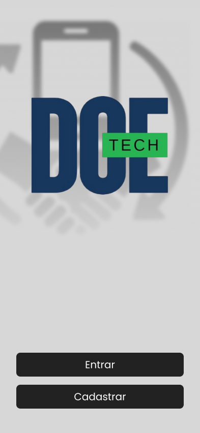

Figura 2: Inicío.

Figura 3: Login.

-wireframe.jpg)

Figura 4: Recuperação de senha.

-wireframe-1.jpg)

Figura 5: Recuperação de senha (modal).

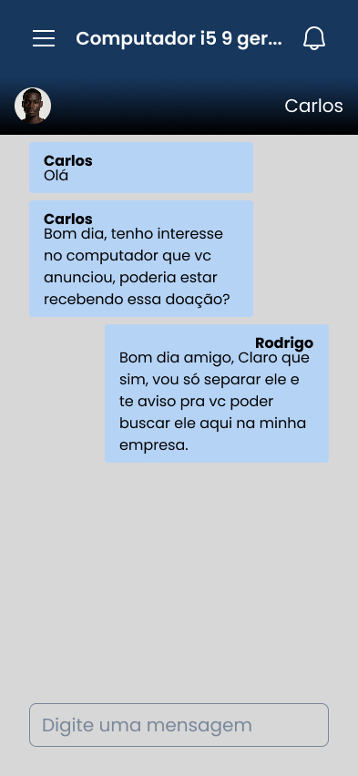

Figura 6: Chat.

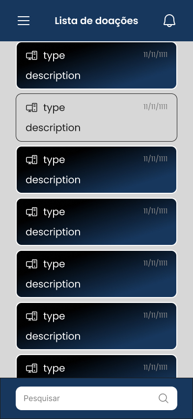

Figura 7: Lista de doações.

-wireframe.jpg)

Figura 8: Cadastro 1.

-wireframe.jpg)

Figura 9: Cadastro 2.

Figura 10: Menu (variação).

-wireframe.jpg)

Figura 11: Menu.

Figura 12: Perfil com documentação pendente.

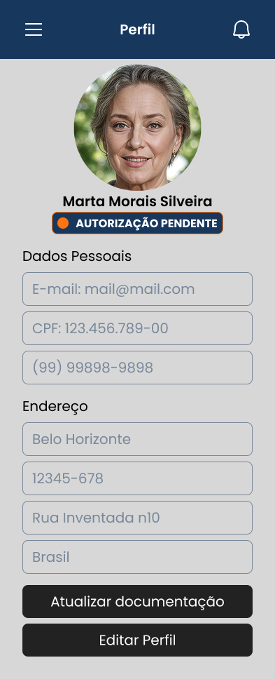

Figura 13: Perfil aguardando autorização.

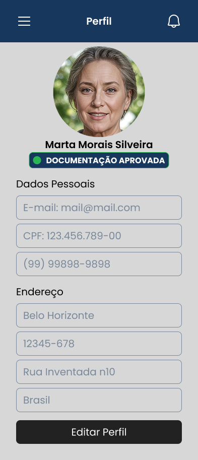

Figura 14: Perfil aprovado.

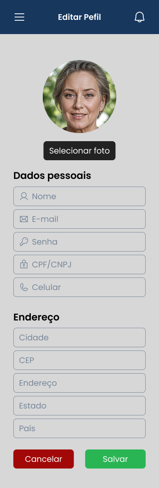

Figura 15: Editar conta.

### Receptor

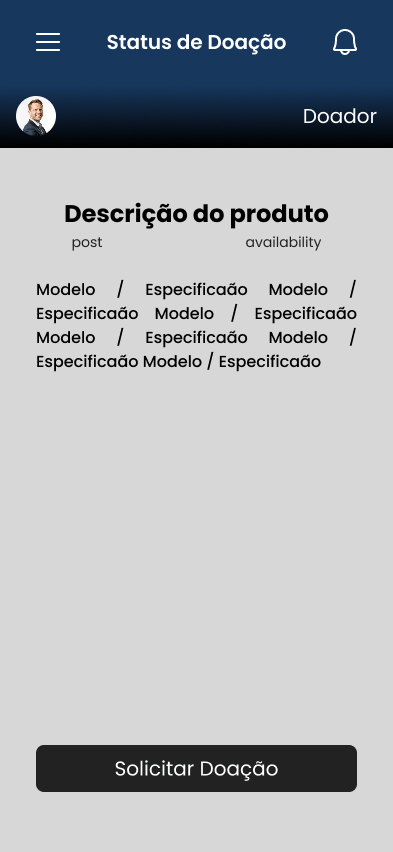

Figura 16: Visualizar doação.

### Doador

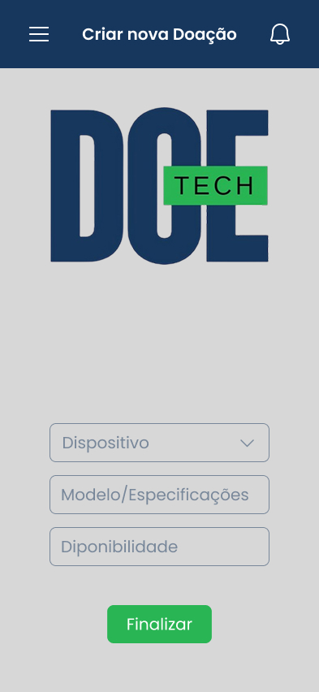

Figura 17: Anunciar doação.

Figura 18: Doador com documentação pendente.

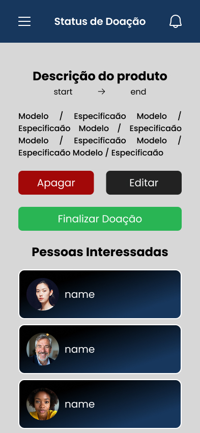

Figura 19: Status da doação.

Figura 20: Editar doação.

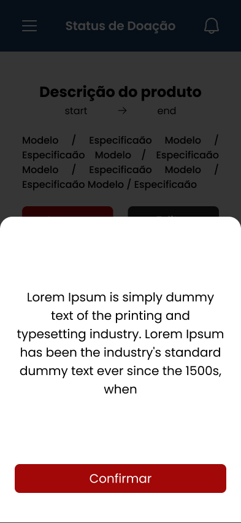

Figura 21: Alerta ao apagar doação (modal).

### Administrador

Figura 22: Menu.

autorizacoes-pendentes-wireframe.jpg)

Figura 23: Autorizações pendentes.

autorizar-perfil-wireframe.jpg)

Figura 24: Autorizar perfil.

perfil-wireframe.jpg)

Figura 25: Perfil administrador.

status-doacao-wireframe.jpg)

Figura 26: Status da doação.

-modal-chat-wireframe.jpg)

Figura 27: Abrir chat com participantes.

editar-conta-wireframe.jpg)

Figura 28: Editar conta.

ver-conversa-wireframe.jpg)

Figura 29: Visualizar conversa entre doador e receptor.

### Dashboards

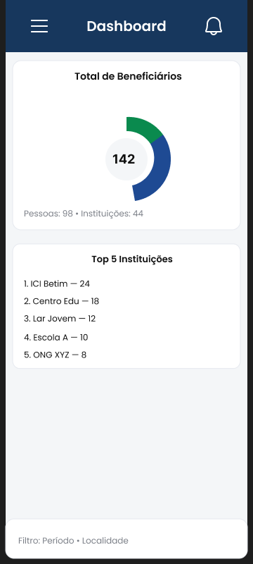

Figura 30: Dashboard de beneficiários.

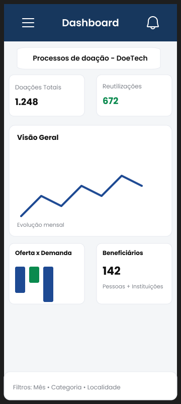

Figura 31: Dashboard geral de administrador.

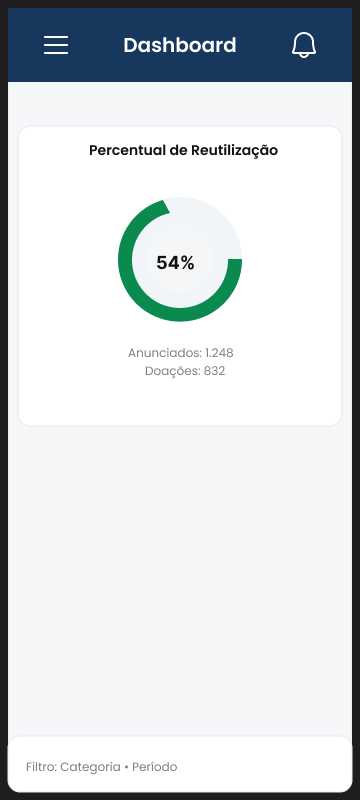

Figura 32: Dashboard de taxa de reutilização.

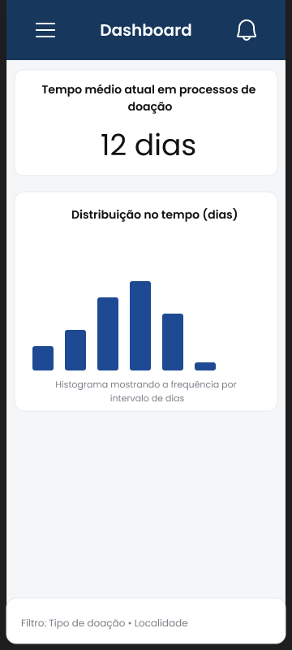

Figura 33: Dashboard de tempo médio de doações.

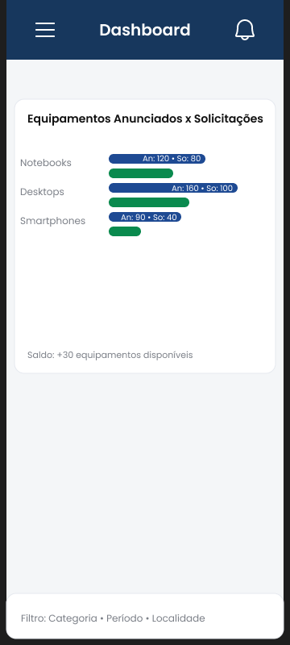

Figura 34: Dashboard de oferta e demanda.

