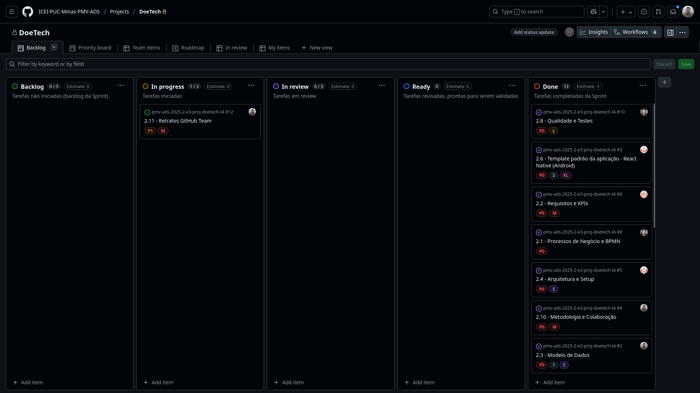
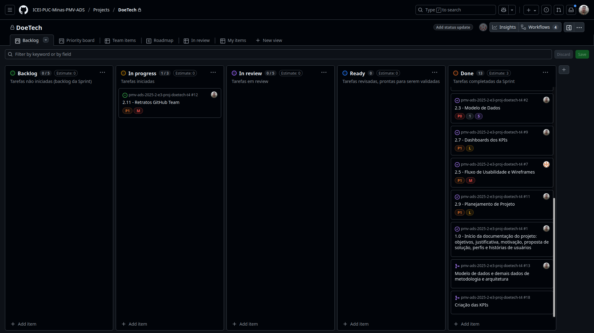
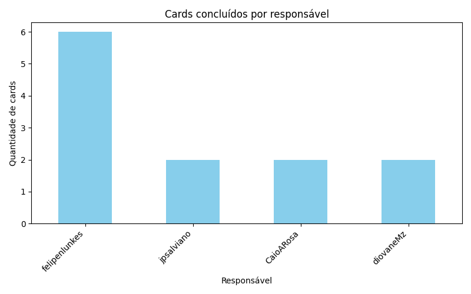
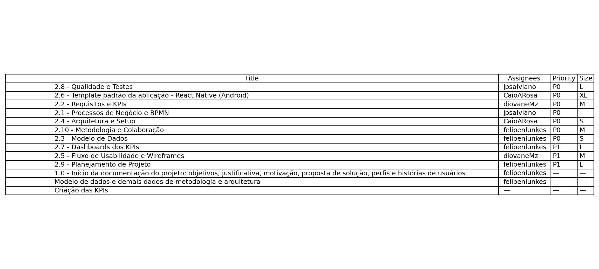
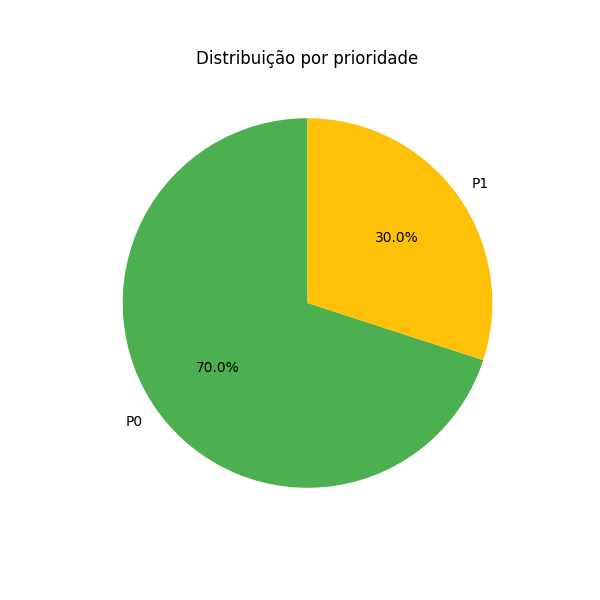
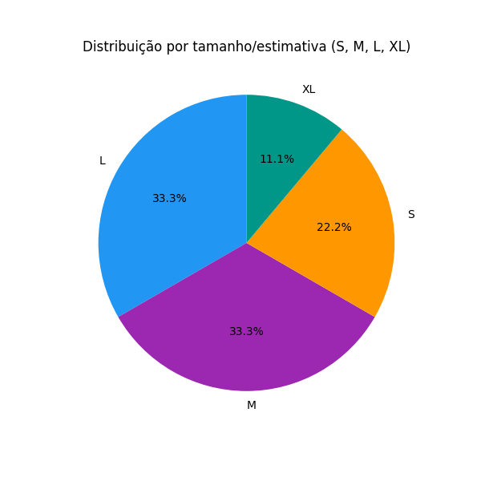
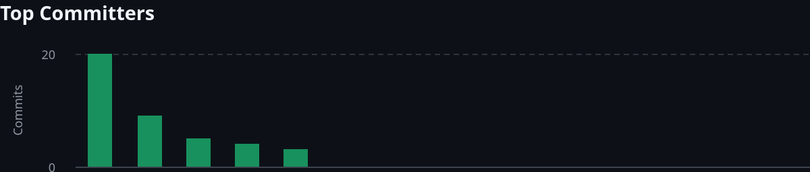
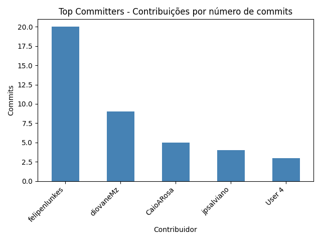

# Retrato atual do andamento do projeto

<div align="justify">

Este documento é um relatório do andamento e participação dos integrandes do time em relação ao projeto. Para isso, serão informadas as contribuições, aparência do board do [GitHub Projects](https://github.com/orgs/ICEI-PUC-Minas-PMV-ADS/projects/2317/views/1) e número de *commits*/*Pull Requests* (PRs).

## Board do GitHub Projects

Ao final da sprint, esta é a aparência do board Kanban do GitHub Projects:

<div align="center">



Figura 1: Board do GitHub Projects - parte 1.



Figura 2: Board do GitHub Projects - parte 2.

</div>

## Card associados

Abaixo, temos uma análise de número de cards criados na sprint, o número de cards concluídos (figura 3), com seus responsáveis e descrição/identificador (figura 4), distribuídos por prioridade (figura 5) e por tamanho da demanda (figura 6).

<div align="center">



Figura 3: Número de cards concluídos por cada integrante do time.



Figura 4: Cards concluídos da sprint, com sua descrição/identificador, responsável, prioridade e tamanho da demanda.



Figura 5: Cards concluídos da sprint, classificados por priorização.



Figura 6: Cards concluídos da sprint, classificados por estimativa da demanda.

</div>

Todos os gráficos desta seção foram criados com o auxílio de um export do GitHub Projects e um script em Python criado pela equipe (executado no PyCharm no Ubuntu 25.04, com licença `BSD-3-Clause`):

```python
import pandas as pd
import matplotlib.pyplot as plt

# Autores: equipe do DoeTech
# Licença: BSD-3-Clause

# Carregar CSV exportado
df = pd.read_csv("github_export.csv", sep="\t")

# Filtrar apenas cards concluídos
done = df[df["Status"].str.lower() == "done"]

print(f"Total de cards concluídos: {len(done)}")

# Gráfico - Cards por responsável
plt.figure(figsize=(10, 5))
done["Assignees"].value_counts().plot(kind="bar", color="skyblue")
plt.title("Cards concluídos por responsável")
plt.xlabel("Responsável")
plt.ylabel("Quantidade de cards")
plt.xticks(rotation=45, ha="right")
plt.tight_layout()
plt.savefig("etapa2_cards_concluidos.png", dpi=200)
plt.show()

# Gráfico - Distribuição por prioridade
plt.figure(figsize=(6, 6))
done["Priority"].value_counts().plot(
    kind="pie",
    autopct="%1.1f%%",
    startangle=90,
    colors=["#4CAF50", "#FFC107", "#F44336"]
)
plt.title("Distribuição por prioridade")
plt.ylabel("")
plt.tight_layout()
plt.savefig("etapa2_graficos_priorizados.png", dpi=200)
plt.show()

# Gráfico - Distribuição por tamanho/estimativa
sizes = done["Size"].dropna()

plt.figure(figsize=(6, 6))
sizes.value_counts().plot(
    kind="pie",
    autopct="%1.1f%%",
    startangle=90,
    colors=["#2196F3", "#9C27B0", "#FF9800", "#009688"]
)
plt.title("Distribuição por tamanho/estimativa (S, M, L, XL)")
plt.ylabel("")
plt.tight_layout()
plt.savefig("etapa2_graficos_estimativa.png", dpi=200)
plt.show()

# Tabela - Cards concluídos (título, responsável, prioridade, tamanho)

table_data = done[["Title", "Assignees", "Priority", "Size"]].fillna("—")

fig, ax = plt.subplots(figsize=(12, len(table_data) * 0.5))
ax.axis("off")

table = ax.table(
    cellText=table_data.values,
    colLabels=table_data.columns,
    loc="center",
    cellLoc="left"
)

# Ajustes visuais
table.auto_set_font_size(False)
table.set_fontsize(9)
table.auto_set_column_width([0, 1, 2, 3])

plt.savefig("etapa2_cards_responsaveis.png", bbox_inches="tight", dpi=200)
plt.show()

```

## Número total de commits

Abaixo, uma figura que ilustra, após exportação de dados da sprint, o número de commits no repositório do projeto, por responsável (figuras 7 e 8).

<div align="center">



Figura 7: Número de contribuições por usuário.



Figura 8: Número de contribuições por usuário.

</div>

Nota: é possível observar que os commits de `User 4` foram feitos com o uso de outro email do integrante Felipe Lunkes, antes da configuração para utilização, no respositório, do email pessoal cadastrado no GitHub.

</div>

